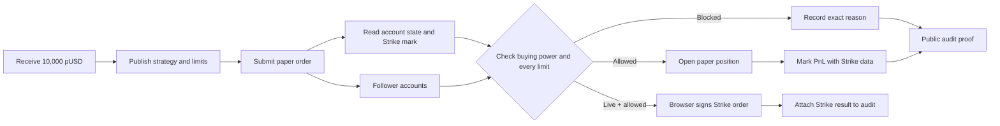

<div align="center">


**Discover strategies by the rules they keep.**

[Open the app](https://limitleague.vercel.app) · [Explore Strike Finance](https://www.strikefinance.org) · [Strike API docs](https://docs.strikefinance.org/api/getting-started)

</div>

LimitLeague is a paper-first strategy discovery and following platform for Strike Finance. It lets a trader publish a strategy with hard risk limits, test decisions against live Strike markets, and build a public record that followers can verify before they follow.

## Why LimitLeague

A return tells you what happened. It does not tell you how much risk a strategy took to get there. LimitLeague puts the risk contract first: every strategy publishes hard limits, and every paper or live trade proposal receives an allow or block decision against those limits. The strategy's record is public, so people can inspect its discipline before following it.

LimitLeague is built for the Strike Finance ecosystem and uses live Strike mark prices for every paper fill and open position. The paper league is ready immediately: no email, wallet, private key, or deposit is required.

## What you can do

| Explore | Publish | Follow |
| --- | --- | --- |
| Compare public strategies, limits, paper returns, follower counts, and decision histories. | Set caps for position size, daily loss, total exposure, and open positions. Pause immediately or tighten limits with a public record of the change. | Paper-follow a strategy. Each proposal is checked against **your own** paper portfolio under the strategy's published limits. |

The paper league needs no wallet, email, or private key. A separate live execution path can connect a trade-only Strike API wallet when a publisher is ready for mainnet orders; it is never required to explore, publish, follow, or test a paper strategy.

Every browser workspace receives a persisted 10,000 pUSD paper allocation. The account view shows equity, available buying power, open exposure, live PnL, closable positions, and its funding ledger. pUSD is virtual trading credit and has no cash value.

The public audit trail records allowed and blocked proposals with the exact limits and portfolio state used by the checker. Each new decision has a SHA-256 proof ID and a shareable verification link. Performance shown in the app is paper mark-to-market performance derived from positions and current Strike marks; closing a position realizes its PnL into the paper ledger, while a strategy with no trades shows no return.

## How the platform works



1. A private paper workspace is created automatically and funded once with 10,000 pUSD.
2. A publisher declares the strategy's maximum position, daily loss, total exposure, open-position count, and automatic pause rule.
3. A paper order selects one of the live Strike markets. LimitLeague reads the current mark and the persisted paper portfolio.
4. The deterministic checker evaluates buying power and every published limit before a position can open.
5. Allowed paper orders become paper positions. Blocked orders never change the paper account. Optional live execution is a separate path with its own Strike API-wallet confirmation.
6. The decision, price, rule snapshot, portfolio snapshot, reason, and SHA-256 proof ID enter the public audit.
7. Followers receive the same proposed order, checked independently against their own account state.

Published limits can be tightened and strategies can be paused immediately. A strategy's public performance comes from compliant paper positions marked with current Strike data.

## Paper balances and outcomes

Each workspace starts with 10,000 pUSD. pUSD is a virtual testing balance, so it cannot be deposited or withdrawn. A position's unrealized PnL moves with the current Strike mark. **Close & realize** removes the position and records the result in the pUSD ledger. No return is shown for a strategy until it has an actual paper position or realized result; LimitLeague does not manufacture profitable examples.

The current product contract is open, mark, and close. Take-profit and stop-loss triggers are not silently simulated as if they were live orders; they would require additional published strategy rules and audit events.

## How to use LimitLeague

1. Open [limitleague.vercel.app](https://limitleague.vercel.app). The paper workspace starts automatically; no registration form is required.
2. Open **Account** to confirm the pUSD allocation, equity, available buying power, exposure, positions, and ledger.
3. Open **Publish**, describe the strategy, set all four hard limits, and publish the rule set.
4. Open the strategy from **League**, choose any active Strike market, select long or short, enter the notional, and submit a paper proposal.
5. Read the allow or block result. The panel shows the resulting position size and exposure against the published ceilings.
6. Return to **Account** to track live unrealized PnL or close an open position at the current Strike mark.
7. Open **Audit**, select a decision, and inspect its exact inputs, outputs, block reasons, timestamp, source, and SHA-256 proof ID. Use **Copy verification link** to share that record.
8. Select another publisher's strategy and choose **Paper follow**. Future proposals are checked against your own paper account under that strategy's limits.
9. Owners can pause a strategy instantly or publish tighter limits from the strategy controls; each change remains visible in the audit trail.

## Run locally

Requirements: Node.js 22+, PostgreSQL, and network access to the Strike Finance API.

```bash
git clone https://github.com/Datwebguy/Limitleague.git
cd Limitleague
npm ci
cp .env.example .env.local
```

Set `DATABASE_URL` in `.env.local` to a PostgreSQL connection string, then run:

```bash
npm run dev
```

Open [http://localhost:3000](http://localhost:3000). Database tables are created on first use. The public Strike price feed works without an API wallet.

| Variable | Purpose |
| --- | --- |
| `DATABASE_URL` | Persistent PostgreSQL connection for users, sessions, strategies, positions, and audit records. |
| `STRIKE_API_BASE_URL` | Strike API origin; defaults to `https://api.strikefinance.org`. |
| `PAPER_STARTING_BALANCE_USD` | One-time pUSD allocation for a new paper workspace; defaults to `10000`. |

## Checks

```bash
npm run typecheck
npm test
npm run build
```

The tests cover limit decisions. With `DATABASE_URL` set, the integration test also exercises PostgreSQL, the public Strike price feed, follower checks, and the audit trail.

## Architecture

The app uses Next.js and React for the interface and API routes, PostgreSQL for durable state, and a deterministic TypeScript limit checker as the source of truth for proposal decisions. Anonymous paper workspaces use private HTTP-only session cookies, so judges can start immediately without an email flow or wallet. Strike's public API supplies the market catalog, marks, and funding data. An optional live execution path verifies a connected API wallet and applies the same server-side check before a browser-signed order reaches Strike; paper users never handle those credentials.

LimitLeague was created for the Strike Hackathon.
