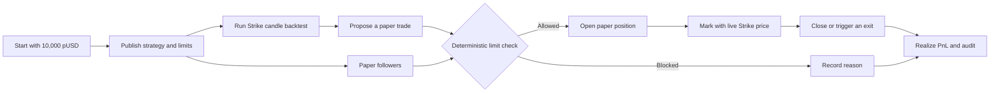

<div align="center">


# LimitLeague

**Discover strategies by the rules they keep.**

[Open the app](https://limitleague.vercel.app) · [Strike Finance](https://www.strikefinance.org) · [Strike API docs](https://docs.strikefinance.org/api/getting-started)

</div>

LimitLeague is a paper-first strategy discovery and following platform built on Strike Finance. Traders publish a strategy together with hard, public risk limits. Every proposal is checked before it can open a paper position or reach Strike. Followers can inspect the proof, paper-follow the strategy, and see the same rules applied to their own account.

## Why it exists

Most trading leaderboards reward the biggest return without showing the risk taken to produce it. LimitLeague makes the risk contract visible first. A strategy earns a place in the league by showing a public record of decisions that stayed inside its own limits.

## Product features

- **Strategy Studio:** choose a live Strike market, momentum, mean-reversion, or breakout behavior, and optional take-profit and stop-loss rules.
- **Real backtesting:** run a seven-day test against Strike's public hourly candles before publishing.
- **Hard limits:** publish maximum position size, daily loss, total exposure, maximum open positions, and automatic pause behavior.
- **Deterministic enforcement:** every proposal is checked against the current portfolio and published limits before a position is opened.
- **Paper-first access:** every workspace starts with virtual pUSD. No email, wallet, private key, deposit, or sign-in flow is required to test the product.
- **Public audit proofs:** allowed proposals, blocked proposals, reasons, rule snapshots, portfolio state, timestamps, and SHA-256 event proofs are inspectable. A strategy owner's decisions form a hash chain: each proof commits to the one before it, and anyone can recompute the whole chain from the app or `GET /api/audit/verify?strategyId=…`.
- **Discipline-weighted ranking:** the league scores return on the published exposure budget, scaled by compliance (allowed decisions ÷ all decisions). Only the owner's own record counts, blocked attempts lower a score, and losses are never softened.
- **Following:** paper-follow (and unfollow) a strategy. Followers receive the same proposals under their own buying power and risk state; their results never count toward the strategy's rank.
- **Real outcomes:** open positions use live Strike mark prices; closing or an exit trigger realizes PnL into the paper ledger. Take-profit and stop-loss levels are checked against the mark-price path since entry (not just the latest tick), fill at the level, are settled before every risk check, and are swept daily by a scheduled job.
- **Optional live path:** a trade-only Strike API wallet can be connected separately when a publisher is ready for live orders. It is never needed for paper trading. See [What is enforced where](#what-is-enforced-where).

## How it works



1. Open the app. A private paper workspace is created automatically with 10,000 pUSD.
2. Publish a strategy with its market, behavior, exits, and four hard limits.
3. Run the backtest to see return, drawdown, win rate, blocked signals, and compliance.
4. Submit a long or short paper proposal. LimitLeague reads the live Strike mark and current portfolio before deciding.
5. Allowed proposals open a paper position. Blocked proposals do not change the account and show the exact reason.
6. Review the strategy in **League**, the account and ledger in **Account**, and every decision in **Audit**.
7. Paper-follow another strategy. Its proposals are evaluated against your own paper balance, exposure, and open positions.

## What is enforced where

| Path | Enforcement |
| --- | --- |
| Paper trading | **Hard, server-side.** Every proposal is checked in a database transaction under a strategy lock; nothing opens a position without passing. |
| Live Strike orders | **Checked and recorded, not enforced.** The server verifies the API-wallet session, reads the Strike account, runs the same checker, and stores the decision. The browser then signs and submits the order itself, so a determined user could bypass the check. What the audit proves is that the order was checked, and the server confirms against Strike that a reported order matches the checked proposal (symbol, side, size, not rejected, and used once). Hard enforcement would need a server-held signing key, which is deliberately not built: LimitLeague never holds trading keys. |

## Risk rules

The checker is the source of truth. It evaluates position size, daily loss, total exposure, open-position count, buying power, pause state, and the strategy's published market. Orders below Strike's minimum notional, and markets Strike does not list as trading, are refused before they are recorded. Owners may pause a strategy or tighten its limits; a published limit cannot be loosened through the app. Every decision stores the inputs and output used by the checker.

The daily loss limit watches today's result only: a position carried over from yesterday is measured from the 00:00 UTC price, and a close books only today's part of its realized result.

## Paper balances and PnL

pUSD is virtual testing credit and has no cash value. It cannot be deposited or withdrawn. Unrealized PnL follows the current Strike mark price. **Close & realize** removes a position and records the realized result in the ledger. Strategies with no real paper position do not receive an invented return.

Paper fills happen at the Strike mark with no spread, fees, funding, or leverage, so paper results are optimistic compared with live trading. Adding to a position re-bases its take-profit and stop-loss on the new average entry at the same percentages.

## Run locally

Requirements: Node.js 22+, PostgreSQL, and network access to Strike's public API.

```bash
git clone https://github.com/Datwebguy/Limitleague.git
cd Limitleague
npm ci
cp .env.example .env.local
npm run dev
```

Set `DATABASE_URL` in `.env.local`. The schema is created on first use (and retried if the database was unreachable at start). The public Strike market catalog, mark prices, funding data, and candle history work without an API wallet.

| Variable | Purpose |
| --- | --- |
| `DATABASE_URL` | PostgreSQL connection for workspaces, strategies, positions, and audits. |
| `STRIKE_API_BASE_URL` | Strike API origin; defaults to `https://api.strikefinance.org`. |
| `PAPER_STARTING_BALANCE_USD` | Initial pUSD allocation; defaults to `10000`. |
| `PAPER_WORKSPACES_PER_NETWORK_PER_HOUR` | New anonymous workspaces one network address may create per hour; defaults to `30`. |
| `CRON_SECRET` | Bearer secret for the daily exit sweep at `/api/cron/settle` (scheduled in `vercel.json`). Without it the endpoint stays disabled. |

## API

| Route | Purpose |
| --- | --- |
| `GET /api/strategies` | The league: standings, compliance, and followers. |
| `POST /api/strategies`, `PATCH /api/strategies` | Publish a strategy; pause, resume, or tighten limits. |
| `POST /api/proposals` | Submit a paper proposal (owner only). |
| `POST /api/follows`, `DELETE /api/follows` | Follow or unfollow a strategy. |
| `GET /api/portfolio`, `POST /api/positions/close` | Your paper account, and manual close. |
| `GET /api/audit?strategyId=&limit=&before=` | The public decision record, cursor-paged and filterable by strategy. |
| `GET /api/audit/[id]` | One decision. Owner decisions are public; a follower can read their own. |
| `GET /api/audit/verify?strategyId=` | Recompute a strategy's proof chain. |
| `POST /api/backtest` | Seven-day candle backtest including the daily loss pause. |
| `GET /api/cron/settle` | Scheduled exit sweep (bearer `CRON_SECRET`). |

Mutating routes require a same-origin request and are rate limited; workspace creation is capped per network in the database. The app sends a strict Content-Security-Policy and framing, sniffing, referrer, and permissions headers.

## Checks

```bash
npm run typecheck
npm test
npm run build
```

The suite covers the limit checker, backtest, proof chain, exit logic, rate limiter, and error handling as pure tests. With `DATABASE_URL` configured it also runs integration tests against PostgreSQL and live Strike data: leaderboard integrity, compliance scoring, audit paging and privacy, hash-chain tamper detection, exit settlement, validation, unfollowing, and startup recovery. CI runs all of it against a Postgres service.

## Architecture

LimitLeague uses Next.js and React for the product, PostgreSQL for durable state, Strike public endpoints for market data, and a deterministic TypeScript limit checker for compliance. HTTP-only paper sessions let judges start immediately. The optional live path applies the same server-side check before a browser-signed order reaches Strike through an API Wallet.

## Known limitations

- Anonymous workspaces live in one browser cookie; clearing it orphans that workspace and its strategies.
- The audit chain is tamper-*evident*: edits and removals in the middle of a chain are detected, but dropping the newest events is only detectable by someone who recorded the chain head earlier (the verify endpoint returns it).
- Exit sweeps run daily on the scheduled job and on every account, proposal, and portfolio request; sub-daily sweeping needs a faster schedule.
- The in-process rate limiter is per server instance; durable limits exist only for workspace creation.
- A lot added to a position carried over from a previous day is measured from that day's open for the daily-loss figure.

LimitLeague was built for the Strike Hackathon.
