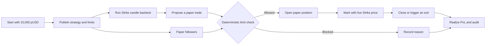

<div align="center">


# LimitLeague

**Discover strategies by the rules they keep.**

[Open the app](https://limitleague.vercel.app) · [Strike Finance](https://www.strikefinance.org) · [Strike API docs](https://docs.strikefinance.org/api/getting-started)

</div>

LimitLeague is a paper-first strategy discovery and following platform built on Strike Finance. Traders publish a strategy together with hard, public risk limits. Every proposal is checked before it can open a paper position or reach Strike. Followers can inspect the proof, paper-follow the strategy, and see the same rules applied to their own account.

## Why it exists

Most trading leaderboards reward the biggest return without showing the risk taken to produce it. LimitLeague makes the risk contract visible first. A strategy earns a place in the league by showing a public record of decisions that stayed inside its own limits.

## Product features

- **Strategy Studio:** choose a live Strike market, momentum, mean-reversion, or breakout behavior, and optional take-profit and stop-loss rules.
- **Real backtesting:** run a seven-day test against Strike's public hourly candles before publishing.
- **Hard limits:** publish maximum position size, daily loss, total exposure, maximum open positions, and automatic pause behavior.
- **Deterministic enforcement:** every proposal is checked against the current portfolio and published limits before a position is opened.
- **Paper-first access:** every workspace starts with virtual pUSD. No email, wallet, private key, deposit, or sign-in flow is required to test the product.
- **Public audit proofs:** allowed proposals, blocked proposals, reasons, rule snapshots, portfolio state, timestamps, and SHA-256 event proofs are inspectable.
- **Following:** paper-follow a strategy and receive the same proposals under your own buying power and risk state.
- **Real outcomes:** open positions use live Strike mark prices; closing or an exit trigger realizes PnL into the paper ledger.
- **Optional live path:** a trade-only Strike API wallet can be connected separately when a publisher is ready for live orders. It is never needed for paper trading.

## How it works



1. Open the app. A private paper workspace is created automatically with 10,000 pUSD.
2. Publish a strategy with its market, behavior, exits, and four hard limits.
3. Run the backtest to see return, drawdown, win rate, blocked signals, and compliance.
4. Submit a long or short paper proposal. LimitLeague reads the live Strike mark and current portfolio before deciding.
5. Allowed proposals open a paper position. Blocked proposals do not change the account and show the exact reason.
6. Review the strategy in **League**, the account and ledger in **Account**, and every decision in **Audit**.
7. Paper-follow another strategy. Its proposals are evaluated against your own paper balance, exposure, and open positions.

## Risk rules

The checker is the source of truth. It evaluates position size, daily loss, total exposure, open-position count, buying power, pause state, and the strategy's published exit rules. Owners may pause a strategy or tighten its limits; a published limit cannot be loosened through the app. Every decision stores the inputs and output used by the checker.

## Paper balances and PnL

pUSD is virtual testing credit and has no cash value. It cannot be deposited or withdrawn. Unrealized PnL follows the current Strike mark price. **Close & realize** removes a position and records the realized result in the ledger. Strategies with no real paper position do not receive an invented return.

## Run locally

Requirements: Node.js 22+, PostgreSQL, and network access to Strike's public API.

```bash
git clone https://github.com/Datwebguy/Limitleague.git
cd Limitleague
npm ci
cp .env.example .env.local
npm run dev
```

Set `DATABASE_URL` in `.env.local`. The schema is created on first use. The public Strike market catalog, mark prices, funding data, and candle history work without an API wallet.

| Variable | Purpose |
| --- | --- |
| `DATABASE_URL` | PostgreSQL connection for workspaces, strategies, positions, and audits. |
| `STRIKE_API_BASE_URL` | Strike API origin; defaults to `https://api.strikefinance.org`. |
| `PAPER_STARTING_BALANCE_USD` | Initial pUSD allocation; defaults to `10000`. |

## Checks

```bash
npm run typecheck
npm test
npm run build
```

The test suite covers limit decisions. With `DATABASE_URL` configured, the integration test also exercises PostgreSQL, Strike prices, following, paper positions, and audit records.

## Architecture

LimitLeague uses Next.js and React for the product, PostgreSQL for durable state, Strike public endpoints for market data, and a deterministic TypeScript limit checker for compliance. HTTP-only paper sessions let judges start immediately. The optional live path applies the same server-side check before a browser-signed order reaches Strike through an API Wallet.

LimitLeague was built for the Strike Hackathon.
