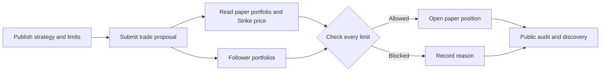

<div align="center">


**Discover strategies by the rules they keep.**

[Open the app](https://limitleague.vercel.app) · [Explore Strike Finance](https://www.strikefinance.org) · [Strike API docs](https://docs.strikefinance.org/api/getting-started)

</div>

## Why LimitLeague

A return tells you what happened. It does not tell you how much risk a strategy took to get there. LimitLeague puts the risk contract first: every strategy publishes hard limits, and every paper trade proposal receives an allow or block decision against those limits. The strategy's record is public, so people can inspect its discipline before following it.

LimitLeague is built for the Strike Finance ecosystem and uses live Strike market prices to mark paper positions.

## What you can do

| Explore | Publish | Follow |
| --- | --- | --- |
| Compare public strategies, limits, paper returns, follower counts, and decision histories. | Set caps for position size, daily loss, total exposure, and open positions. Pause immediately or tighten limits with a public record of the change. | Paper-follow a strategy. Each proposal is checked against **your own** paper portfolio under the strategy's published limits. |

The public audit trail records allowed and blocked proposals with their reasons. Performance shown in the app is paper performance derived from positions and current Strike prices; a strategy with no trades shows no return.

## How it works



The deterministic checker evaluates maximum position notional, total open exposure, number of open positions, daily loss, and pause state. The same proposal may be allowed for the publisher and blocked for a follower because their portfolios differ. Pauses take effect immediately; published limits can only be tightened.

## Use the platform

1. **Open the paper league** at [limitleague.vercel.app](https://limitleague.vercel.app). Your private paper session starts automatically.
2. **Publish a strategy** with a name, description, and hard limits.
3. **Submit a paper trade proposal.** LimitLeague gets the current Strike price, checks the rules, and records the decision.
4. **Inspect the audit trail** to see allowed and blocked decisions and rule changes.
5. **Paper-follow a strategy** to apply its published limits to your own paper portfolio.

## Run locally

Requirements: Node.js 22+, PostgreSQL, and network access to the Strike Finance API.

```bash
git clone https://github.com/Datwebguy/Limitleague.git
cd Limitleague
npm ci
cp .env.example .env.local
```

Set `DATABASE_URL` in `.env.local` to a PostgreSQL connection string, then run:

```bash
npm run dev
```

Open [http://localhost:3000](http://localhost:3000). Database tables are created on first use. The public Strike price feed works without an API wallet.

| Variable | Purpose |
| --- | --- |
| `DATABASE_URL` | Persistent PostgreSQL connection for users, sessions, strategies, positions, and audit records. |
| `STRIKE_API_BASE_URL` | Strike API origin; defaults to `https://api.strikefinance.org`. |
| `STRIKE_API_WALLET_PUBLIC_KEY` | Server-side Strike API wallet public key for authenticated Strike requests. |
| `STRIKE_API_WALLET_PRIVATE_KEY` | Server-side signing key. Keep it in your hosting provider's secret store; never commit it. |

## Checks

```bash
npm run typecheck
npm test
npm run build
```

The tests cover limit decisions. With `DATABASE_URL` set, the integration test also exercises PostgreSQL, the public Strike price feed, follower checks, and the audit trail.

## Architecture

The app uses Next.js and React for the interface and API routes, PostgreSQL for durable state, and a deterministic TypeScript limit checker as the source of truth for proposal decisions. Anonymous paper workspaces use private HTTP-only session cookies, so judges can start immediately without an email flow. Strike's public API supplies prices; its authenticated API wallet client is isolated on the server.

LimitLeague was created for the Strike Hackathon.
